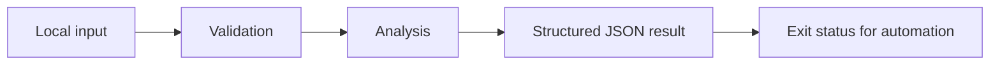

# SLO Report

Request-weighted availability and latency reports with error-budget accounting.

A focused Python command-line project with synthetic examples, explicit behavior, and regression tests. It runs locally without credentials or third-party packages.

## Run it

Requires Python 3.11 or newer.

```sh
python3 slo.py sample.json
python3 -m unittest -v
```

See [VALIDATION.md](VALIDATION.md) for the actual local test output and example result. GitHub Actions runs the suite on Python 3.11, 3.12, and 3.13.

## Design

Each row represents one request. HTTP 5xx counts as an availability failure; 4xx is excluded from failure counts under this example policy. All requests contribute to latency statistics. Percentiles use nearest-rank, not interpolation. The available error budget is request count × (1 − target); the report preserves fractional request budgets. Exit 1 means the availability target was missed; exit 2 means invalid input.



## Scope and limitations

No timestamps, rolling windows, multi-window burn-rate alerting, histogram approximation, or telemetry ingestion. This is a request-weighted report for a caller-selected window. The latency threshold is reported separately and does not change the availability gate. Small samples are not statistically representative of long-term service reliability.

## Project layout

- `slo.py`: core functions and command-line entry point.
- `test_slo.py`: behavioral tests, including invalid inputs and boundary cases.
- `sample.json`: fictional example input or example notes.
- `VALIDATION.md`: reproducible local validation record.
- `.github/workflows/tests.yml`: automated tests with read-only repository permissions.

The core functions can be imported independently of the command line. Input files are never modified. Sample data is synthetic; the repository does not claim production usage or customer results.

MIT licensed.
